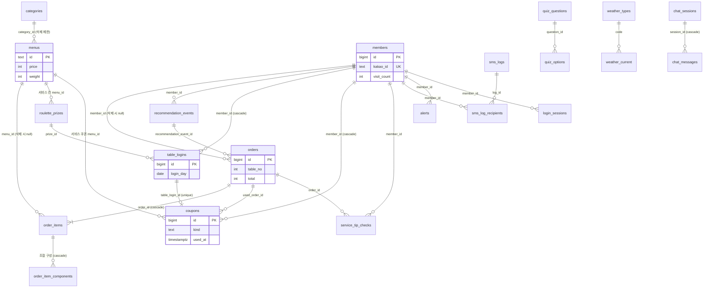

# F&BGrowth DB 설계 (Supabase / Postgres)

> **문서 목적**: 프로젝트 평가용 DB 설계 최종본입니다. 테이블 정의·관계(ERD)·제약조건·뷰/함수·보안(RLS)·API 대응을 한 곳에 정리했습니다.
> 실행용 SQL은 [`docs/db/fbgrowth_schema.sql`](../db/fbgrowth_schema.sql)이고, 운영 Supabase `table-order` 프로젝트의 실제 상태(2026-10-21 조회: 서비스 테이블 28개 + 개발용 `test` 1개, 뷰 2개, RLS 전부 켜짐)와 일치함을 확인했습니다.
> 관련 문서: [API 설계](API_설계.md) · [화면 설계](화면_설계.md)
> 근거 표시: 이 문서의 모든 내용은 위 SQL과 `backend/app/` 코드에서 확인한 것입니다. 확인하지 못한 것은 **[확인 필요]** 로 표시했습니다.

## 한 단락 요약

테이블 28개, 뷰 2개, 함수 2개(`set_updated_at`, `member_grade`)로 이뤄진 Postgres 스키마입니다. 매장·메뉴, 회원·QR 로그인·룰렛, 주문·직원 호출, AI 추천 콘텐츠, 관리자(알림·문자·챗봇)를 다룹니다. FastAPI 서버가 서비스 롤로 접속하므로 RLS를 우회하고, 모든 테이블에 RLS를 켜서 브라우저·anon 키 접근을 막으며 손님 화면용 공개 콘텐츠 10개만 anon 읽기를 허용합니다. 정수 ID는 `bigint identity`, 메뉴·카테고리 ID는 기존 문자열(`c1`, `chicken`)을 유지하고, 시각은 `timestamptz`(UTC 저장, 화면에서 KST 변환)입니다.

**적용 상태(2026-10-21 확인): Supabase `table-order` 프로젝트에 적용돼 있습니다.** 서비스 테이블 28개(손님 응대 제안 확인 기록 `service_tip_checks` 포함), RLS 전부 켜짐(`coupons`와 룰렛 하루 1회 인덱스는 2026-10-16 마이그레이션으로 추가). 서버(`backend/app/stores/`)는 `DATABASE_URL`이 Postgres면 이 스키마에, 비어 있으면 로컬 SQLite(`backend/app.db`, 테스트용)에 붙습니다(`stores/db.py`가 SQL을 변환). [확인 필요: 모든 stores 쿼리의 Supabase 실행 여부는 이번에 코드만 대조했고 전수 실행은 하지 않음]

개발 흐름 확인용 `test` 테이블(서비스 테이블 아님, 위 28개에 포함하지 않음)은 `docs/db/fbgrowth_test_table.sql`이고 2026-10-16에 적용했습니다. 각자의 TODO 0번 단계에서 쓰기·읽기 확인에 씁니다.

## 목차

1. [결정 사항](#결정-사항)
2. [테이블 목록과 목적](#테이블-목록과-목적)
3. [관계(ERD)](#관계erd)
4. [제약조건·인덱스·트리거](#제약조건인덱스트리거)
5. [뷰·함수](#뷰함수)
6. [보안(RLS)](#보안rls)
7. [API ↔ 테이블 대응](#api-v6--테이블-대응)
8. [SQLite 구조와 달라진 점](#현재-db와-달라진-점)
9. [열린 사항](#열린-사항)
10. [SQL 파일 안내](#sql-파일-안내)

## 결정 사항

사용자가 확정한 것과 설계 기준입니다. 새 코드를 짤 때 이 항목과 어긋나지 않게 합니다.

| 항목 | 결정 | 스키마·코드에 미치는 영향 |
|---|---|---|
| 주문 상태 | 기능·UI 제거. `orders`에 상태 컬럼 없음 | 손님 주문내역의 접수·조리중·서빙완료 표시는 이미 제거됨(커밋 `9ccdcfc`). 상태 API를 만들지 않음 |
| 방문 횟수 | 로그인할 때마다 `members.visit_count` +1 | 주문 횟수와 별개. 등급 판정(`member_grade`)이 이 값을 씀 |
| 챗봇 | 제미나이(Gemini) 무료 API, RAG 없음, DB 데이터 기반 답변 | 벡터 테이블·임베딩 없음. 서버가 매출·메뉴 등을 조회해 프롬프트에 넣고, 대화는 `chat_sessions`/`chat_messages`에 저장 |
| 관리자 인증 | 모든 개발이 끝난 뒤 마지막(후순위) | `owners`(Supabase Auth)는 스키마에 있지만 당장 쓰지 않음. 기존 `ADMIN_TOKEN` 방식과 병행 가능 |
| 문자 발송 | 솔라피(Solapi) 확정(발송 확인됨) | `sms_logs`는 공급자와 무관한 구조. 발송 코드는 `backend/app/services/sms.py` |
| 메뉴·카테고리 ID | 문자열 유지 | 기존 시드·화면 코드와 호환. 새 메뉴 ID는 서버가 `m` + 난수로 생성 |
| 룰렛 횟수 | 회원당 하루 1회(KST). 같은 날 다른 테이블에서는 돌릴 수 없고 다른 날은 가능 | `table_logins`에 `unique(member_id, login_day) where played_at is not null` 부분 유니크 인덱스. 로그인 시 오늘 이미 돌렸으면 `roulette_eligible=false` |
| 쿠폰함 | 룰렛 당첨은 바로 적용하지 않고 쿠폰함(`coupons`)에 넣고, 손님이 쿠폰함에서 '사용'하면 장바구니에 적용, 주문이 접수되면 `used_at` 기록 | 룰렛 한 번에 쿠폰 한 장(`table_login_id` unique). 한 테이블에 앉은 회원들의 쿠폰이 한 쿠폰함에 보임. 유효기간은 정책 미정(`expires_at` null = 없음) |
| 테이블 누적 주문 | 해당 테이블의 주문 중 `orders.created_at`이 그 테이블의 현재 로그인 기록(`table_logins`) 가장 이른 `logged_in_at` 이후인 것만 합산 | 별도 테이블 세션 테이블을 만들지 않음. 같은 테이블에 새 손님이 로그인하면 `table_logins`가 새로 쌓이는 시점부터 다시 센다 |
| 룰렛 칸 개수(2~8)·가중치 합 > 0 | SQL 제약이 아니라 서버에서 검증 | 여러 행에 걸친 규칙이라서 |
| `staff_calls.done_at` | 처리 화면은 제거됐지만 컬럼은 남김 | 되살릴 때 마이그레이션 불필요 |
| 전화번호 | 평문 저장(현재와 동일) | 정식 운영 전에 암호화·보관 기간 결정 필요 |

## 테이블 목록과 목적

### 매장·메뉴

| 테이블 | 목적 | 핵심 컬럼 |
|---|---|---|
| `store_info` | 매장 정보(1행만 허용) | name, branch, slogan, tables(전체 테이블 수) |
| `categories` | 메뉴 카테고리 | id, name, icon, color_from/to, is_virtual(`ai`·`best`는 메뉴를 직접 넣지 않음), sort_order |
| `menus` | 메뉴 | id, category_id, name, price, tags[], is_soldout, spicy, weight(추천 가중치), set_ok, is_event(이벤트 서비스 메뉴 후보), image_url |

### 회원·로그인·룰렛

| 테이블 | 목적 | 핵심 컬럼 |
|---|---|---|
| `members` | 카카오 로그인 회원 | kakao_id, auth_user_id, nickname, phone, gender, birth_year, marketing_consent, opted_out, visit_count, last_visit_at |
| `login_sessions` | QR 로그인 진행 상태(서버 메모리에서 이전). JWT는 저장하지 않음 | token, secret, table_no, status(`waiting/scanned/logged_in/rejected/expired`), blocked_member_ids[], marketing_consent, expires_at |
| `roulette_prizes` | 룰렛 칸 구성 | label, short_text, kind(`discount`/`free`), percent, menu_id(서비스 메뉴), weight, sort_order |
| `table_logins` | 테이블 로그인 이력 + 룰렛 참여·당첨 | table_no, member_id, login_day(하루 1회 규칙), roulette_eligible, prize_id, prize_text(문구 사본), played_at |
| `coupons` | 쿠폰함: 룰렛 당첨 쿠폰과 사용 여부 | member_id, table_login_id(unique), table_no, kind(`discount`/`free`), label, percent, menu_id, issued_at, expires_at, used_at, used_order_id |

### 주문·직원 호출

| 테이블 | 목적 | 핵심 컬럼 |
|---|---|---|
| `orders` | 주문 헤더 | table_no, member_id, total, roulette_discount_percent, ai_combo, recommendation_event_id |
| `order_items` | 주문 줄 | order_id, menu_id, kind(`menu/combo/roulette_service`), name, unit_price, original_unit_price, qty |
| `order_item_components` | AI 조합 줄의 구성 메뉴(인기 메뉴 집계용) | order_item_id, menu_id, name, qty |
| `staff_call_items` | 직원 호출 요청 항목(물·수저 등) | label(20자 이하·중복 불가), sort_order |
| `staff_calls` | 직원 호출 기록 | table_no, items[], created_at, done_at |
| `service_tip_checks` | 손님 응대 제안 카드의 '확인' 기록(행이 있으면 확인) | member_id, order_id(기본키 묶음), checked_at |

### AI 추천 콘텐츠

| 테이블 | 목적 | 핵심 컬럼 |
|---|---|---|
| `quiz_questions` / `quiz_options` | 추천 질문과 보기 | 질문 id(hunger·stress·people·gender·kind·spicy·intent·budget), 보기 value·label·emoji |
| `weather_types` / `weather_current` | 날씨 코드 정의 / 현재 날씨 1행 | 코드·라벨·아이콘 |
| `recommendation_rules` | 복잡한 추천 규칙 | key, value(jsonb): discount_percent, pairings, drinks, pair_meta |
| `recommendation_events` | 추천 기록(적중률 집계) | table_no, member_id, answers(jsonb), hour, weather_code, combo_ids[] |

### 관리자

| 테이블 | 목적 | 핵심 컬럼 |
|---|---|---|
| `owners` | 관리자(Supabase Auth 연결, 후순위) | user_id(auth.users), role=OWNER |
| `app_settings` | 설정 key-value | key, value(jsonb): `grade_rule`, `sms_limits` |
| `alerts` | 운영 알림 | kind(`dormant/soldout/other`), title, member_id, menu_id, acknowledged_at |
| `sms_logs` / `sms_log_recipients` | 문자 발송·예약 기록 / 수신 회원 | month, type(SMS/LMS), content, target_count, status(`sent/dry_run/failed/scheduled/canceled`), scheduled_at |
| `external_context` | 오늘 날씨·지역 행사 문구(AI 문자 후보용) | day, weather_text, event_text |
| `chat_sessions` / `chat_messages` | 챗봇 대화 | owner_id, title / session_id, role, content |

## 관계(ERD)

주요 테이블만 그린 관계도입니다(컬럼은 위 표 참고). `||--o{` 는 "1 대 0..N", 괄호는 삭제 규칙입니다.

`auth.users`(Supabase 내장)와 이어지는 곳: `owners.user_id`(1:1), `chat_sessions.owner_id`(1:N), `members.auth_user_id`(선택, 1:1). 독립 테이블(FK 없음): `store_info`, `app_settings`, `external_context`, `recommendation_rules`, `staff_call_items`, `staff_calls`.

## 제약조건·인덱스·트리거

| 대상 | 규칙 | 목적 |
|---|---|---|
| `store_info` | `id = 1` CHECK, `tables >= 1` | 매장 1개만 허용 |
| `weather_current` | `id = 1` CHECK | 현재 날씨 1행 |
| `menus` | `price >= 0`, `spicy 0~3`, `weight 0~100`, `category_id` FK(`on delete restrict`) | 메뉴가 있는 카테고리는 삭제 불가 |
| `menus` 트리거 `menus_virtual_check` | `is_virtual` 카테고리(`ai`·`best`)에는 메뉴 삽입/이동 거부 | 가상 카테고리 보호 |
| `members` | `kakao_id` UNIQUE, `gender in (male,female)`, `visit_count` 기본 0 | 카카오 회원 식별 |
| `login_sessions` | `token`·`secret` UNIQUE, `status` 5종 CHECK | QR 로그인 상태 머신 |
| `roulette_prizes` | `kind=discount → percent 필수·menu_id null`, `kind=free → menu_id 필수·percent null`, 색상 `#RRGGBB` | 칸 종류별 필수값 |
| `table_logins` | `unique(table_no, member_id, login_day)` | 같은 날 같은 테이블 중복 로그인 방지 |
| `table_logins_one_play_per_day` | `unique(member_id, login_day) where played_at is not null` (부분 유니크) | **룰렛 회원당 하루 1회(KST)** |
| `coupons` | `table_login_id` UNIQUE, `kind` CHECK, 종류별 percent 규칙, `used_at null = 사용 가능` | 룰렛 한 번에 쿠폰 한 장 |
| `orders` / `order_items` | `total >= 0`, `qty 1~99`, `kind in (menu,combo,roulette_service)` | 주문 값 검증. 이름·단가는 주문 시점 사본 저장 |
| `staff_call_items` | `label` UNIQUE, 길이 1~20 | 직원 호출 항목 |
| `sms_logs` | `type in (SMS,LMS)`, `status in (sent,dry_run,failed,scheduled,canceled)` | 문자 기록 상태 |
| `alerts` | `kind in (dormant,soldout,other)`, 부분 인덱스(미확인만) | 알림 목록 조회 속도 |
| `owners` | `role = 'OWNER'` CHECK | 관리자는 사장님 한 종류 |
| 주요 인덱스 | `orders(created_at desc)`, `orders(table_no, created_at desc)`, `orders(member_id, created_at desc)`, `menus(category_id, sort_order)`, `members(last_visit_at)`, `coupons(member_id, used_at)` 등 | 통계·목록 조회 |
| `set_updated_at()` 트리거 | `menus`, `chat_sessions`의 `updated_at` 자동 갱신 | 변경 시각 |

서버에서 검증하는 규칙(SQL 제약이 아님): 룰렛 칸 2~8개·확률 합계 100%(`routers/admin/owner.py`), 단골 기준 > 재방문 기준(`routers/admin/members.py`).

## 뷰·함수

| 이름 | 내용 |
|---|---|
| `member_grade(...)` | 휴면(마지막 방문 N일 이상) → 단골 → 재방문 → 신규 순으로 판정. 기존 `grades.py`와 같은 규칙 |
| `v_members_graded` | 회원 + 등급 + 문자 발송 가능 여부(동의·수신거부 아님·번호 있음). 기준은 `app_settings.grade_rule` |
| `v_sms_usage` | 월·종류별 사용량(발송·테스트·예약만 집계, 취소·실패 제외) |

고객 등급 기준 저장(수용 5): 기존 `app_settings`의 `grade_rule` 한 행에 재방문·단골 방문 횟수와 휴면 일수를 저장하고 `updated_at`을 갱신한다. `GET·PUT /admin/api/customers/grades/rules`로 조회·저장하며, 고객 목록·통계·단골 추천·문자 대상은 저장된 기준을 함께 읽는다. 조회 우선순위는 **쿼리 미리보기 > DB 저장값 > 환경 변수 > 코드 기본값**이며 미리보기는 DB를 변경하지 않는다. 별도의 고객 등급 컬럼이나 테이블은 만들지 않는다. 로컬 SQLite의 `app_settings`는 `value`를 JSON 문자열로 저장하며, Supabase의 기존 `jsonb`와 같은 응답을 사용한다. 초기 조회·서버 시작은 기본값 행을 자동 저장하지 않는다.

휴면 **기본값은 30일**로 통일했다(관리자가 저장한 사용자 지정 일수는 유지). 기존 DB에는 [`sooyong_grade_rules_30_days.sql`](../db/sooyong_grade_rules_30_days.sql)을 적용해 함수·뷰의 기본값과 과거 시드 `2회·5회·60일`만 수정한다. 회원·주문 데이터는 삭제하지 않는다. 팀 공유 사항: 문자 발송 담당도 같은 저장 기준을 사용하며, `grade_rule()`의 기존 인자·반환 필드는 유지하고 DB 연결만 선택 인자로 추가했다.

## 보안(RLS)

- 28개 서비스 테이블 모두 `row level security`를 켰습니다. FastAPI 서버가 서비스 롤로 접속하므로 RLS를 우회하고, 브라우저·anon 키로는 접근할 수 없습니다.
- 예외로 손님 화면용 공개 콘텐츠 10개(`store_info`, `categories`, `menus`, `roulette_prizes`, `staff_call_items`, `quiz_questions`, `quiz_options`, `weather_types`, `weather_current`, `recommendation_rules`)만 `anon`/`authenticated` 읽기를 허용합니다.
- `chat_sessions`/`chat_messages`는 `owner_id = auth.uid()`인 본인 것만 접근하는 정책이 있습니다.
- 전화번호는 평문 저장입니다(열린 사항 참고).

## API v6 ↔ 테이블 대응

> 아래 표의 경로는 기획 문서(v6/v7)의 이름입니다. **실제 구현 경로와 요청·응답은 [API 설계](API_설계.md)** 를 보세요.

API 화면 구분은 v6 목록표의 번호(1-1 … 2-10)입니다. "집계"는 별도 테이블 없이 `orders`·`members` 등에서 SQL로 계산한다는 뜻입니다.

### 손님 페이지

| v6 구분 | API | 테이블 |
|---|---|---|
| 1-1 스플래시 | `GET /v1/store` | `store_info` |
| | `GET /v1/roulette/prizes` | `roulette_prizes` |
| | `GET /v1/roulette/status`, `POST /v1/roulette/plays` | `table_logins`, `roulette_prizes` (당첨 시 `coupons`에 쿠폰 발급) |
| | `GET /v1/coupons`, `GET /tables/{n}/coupons` (쿠폰함 조회. v6 목록표에 없던 API) | `coupons` |
| | `POST /v1/auth/qr`, `GET /v1/auth/qr/{secret}` | `login_sessions` |
| | `GET /v1/auth/kakao/start·continue·callback` | `login_sessions`, `members` (`visit_count` +1) |
| | `GET /v1/members/me` | `members` |
| 1-2 주문 | `GET /v1/categories`, `GET /v1/menus` | `categories`, `menus` |
| | `POST /v1/orders` | `orders`, `order_items`, `order_item_components` (요청의 `coupon_ids`는 `coupons.used_at`·`used_order_id`로 기록) |
| 1-3 주문내역 | `GET /v1/tables/{tableId}/orders` | `orders`, `order_items` |
| 1-4 직원 호출 | `GET /v1/staff-call-items`, `POST /v1/staff-calls` | `staff_call_items`, `staff_calls` |
| 1-5 AI 추천 | `GET /v1/ai/questions` | `quiz_questions`, `quiz_options` |
| | `POST /v1/ai/recommendations` | `recommendation_events` (+ `recommendation_rules`, `weather_current`) |
| | `GET /v1/weather/current` | `weather_current`, `weather_types` |
| | `GET /v1/ai/recommendation-rules` | `recommendation_rules` |
| | `GET /v1/ai/preferences/me` | 전용 테이블 없음. `recommendation_events`·`orders` 집계 |
| | `…/recommendations/{id}/alternatives`, `…/feedback` | 전용 테이블 없음(feedback은 필요 시 `recommendation_events` 컬럼 추가) |

### 관리자 페이지

| v6 구분 | API | 테이블 |
|---|---|---|
| 2-1 로그인 | `GET /v1/owner/me` | `owners`, `store_info` (후순위) |
| 2-2 대시보드 | `GET /admin/stats/*` (sales, hourly, trends, weekday, tables, tickets, customers, menus/ranking) | 집계: `orders`, `order_items`, `order_item_components`, `members` |
| | `GET /admin/stats/ai-recommendations` | 집계: `recommendation_events`, `orders` |
| | `GET /admin/customers/grades` | `v_members_graded` |
| | `GET /admin/alerts`, `PATCH /admin/alerts/{id}` | `alerts` |
| 2-3 메뉴 관리 | `GET·POST·PATCH·DELETE /v1/owner/menus…` | `menus` |
| | `POST·PATCH·DELETE /v1/owner/categories…` | `categories` |
| 2-4 추천 가중치 | `PATCH /v1/owner/menus/weights`, 단건 PATCH | `menus.weight` |
| 2-5 이벤트 | `GET /v1/roulette/prizes`, `PUT /v1/owner/roulette/prizes` | `roulette_prizes` |
| 2-6 고객 등급 | `GET /admin/customers`, `…/grades/rules` | `v_members_graded`, `app_settings.grade_rule` |
| 2-7 주문 이력 | `GET /v1/owner/orders` | `orders`, `order_items`, `members` |
| 2-9 AI 문자 | `sms/usage` | `v_sms_usage`, `app_settings.sms_limits` |
| | `sms/preview`, `sms/candidates` | `v_members_graded`, `external_context` |
| | `sms/send`, `sms/logs`, `sms/logs/{id}/cancel` | `sms_logs`, `sms_log_recipients` |
| | `POST /admin/customers/{id}/opt-out` | `members.opted_out` |
| | `GET /admin/marketing/external-context` | `external_context` |
| 2-10 챗봇·추천 | `chat/sessions` 5개 | `chat_sessions`, `chat_messages` |
| | `GET /admin/marketing/opportunities` | 전용 테이블 없음. 집계 + 서버 로직 |

v6에서 "뺄" 처리된 API(`orders/{orderId}`, 메뉴군·날씨별 매출 등 5개 통계)는 테이블을 따로 만들지 않았습니다.

## 현재 DB와 달라진 점

"현재"는 서버가 아직 쓰는 기존 SQLite 구조(`backend/app/stores/*.py` 의 `SCHEMA`)입니다.

| 항목 | 현재 | 변경 |
|---|---|---|
| 화면 콘텐츠 | `content(name, data JSON)` 한 테이블에 통째로 저장 | 카테고리·룰렛·직원호출 항목·질문·날씨는 정규화. 복잡한 추천 규칙만 `recommendation_rules` jsonb |
| 주문 | `orders.lines` JSON 문자열 | `order_items` + `order_item_components`로 분리(메뉴별 집계를 SQL로) |
| 룰렛 | `tablet_logins`에 당첨 문구만 저장 | `table_logins`: 하루 1회(`login_day`), 당첨 칸 연결(`prize_id`), 문구 사본 |
| QR 로그인 세션 | 서버 메모리 | `login_sessions` (서버가 여러 개여도 동작) |
| 시각·불리언 | ISO 문자열·정수 0/1 | `timestamptz`·`boolean` |
| 관리자 | 환경변수 토큰 하나 | `owners` + Supabase Auth (후순위, 토큰 방식과 병행 가능) |
| 새로 생김 | - | `alerts`, `chat_*`, `external_context`, `app_settings`, `sms_log_recipients`, `recommendation_events.answers` |

## 열린 사항

1. **서버를 Supabase 스키마로 이전**: 스키마는 Supabase에 적용됐지만 서버 저장소 코드는 아직 SQLite 호환 구조입니다(위 적용 상태 참고).
2. **데이터 시드**: `docs/db/fbgrowth_seed.sql`(메뉴 60·카테고리 8·퀴즈 8·룰렛 5칸·추천 규칙·직원 호출 8개·매장 정보)을 Supabase SQL Editor에서 실행하면 기본 데이터가 채워집니다(여러 번 실행해도 안전).
3. **개인정보**: 전화번호 암호화·보관 기간.
4. **검증 이력**: Postgres 16에서 스크립트를 두 번 실행해 오류가 없었고(재실행 가능), 제약·트리거·뷰를 샘플 데이터로 확인했습니다. Supabase에서의 실행은 아직 확인되지 않았습니다.

## SQL 파일 안내

모두 `docs/db/`에 있고 Supabase SQL Editor에서 실행합니다(여러 번 실행해도 안전하게 작성됨).

| 파일 | 용도 |
|---|---|
| `fbgrowth_schema.sql` | 전체 스키마(테이블·뷰·함수·RLS·기본 설정) |
| `fbgrowth_seed.sql` | 기본 데이터(메뉴 60·카테고리 8·퀴즈 8·룰렛 5칸·추천 규칙·직원 호출 8·매장 정보) |
| `fbgrowth_menus_is_event.sql` | 기존 DB에 `menus.is_event` 컬럼 추가 |
| `fbgrowth_service_tip_checks.sql` | 기존 DB에 `service_tip_checks` 추가(서버가 처음 쓸 때 자동 생성하기도 함) |
| `sooyong_grade_rules_30_days.sql` | 휴면 기본값 30일로 통일 |
| `fbgrowth_owner_add.sql` | 사장님 계정을 `owners`에 등록 |
| `fbgrowth_sample_data.sql` / `_cleanup.sql` | 시연용 샘플 데이터 넣기 / 지우기 |
| `fbgrowth_test_table.sql` | 개발 흐름 확인용 `test` 테이블 |
